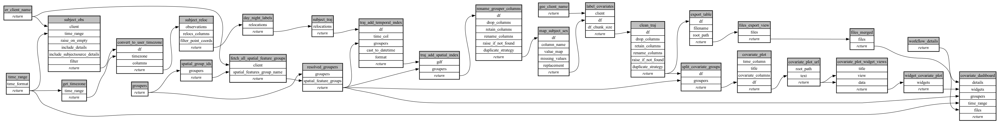

```
# AUTOGENERATED BY ECOSCOPE-WORKFLOWS; see fingerprint in README.md for details

```

```yaml
# fingerprint:
artifacts_sha256_basic: f5dfc43b675a7d117b0a514b30b6a04bee63adea494cef2d2d363cc070d558d9
artifacts_sha256_strict: 723bae64bb947e54cb6c339709dd6bef8423d0b884a3e18876d69a58ed66bc9f
installed_requirements:
- channel: https://repo.prefix.dev/ecoscope-workflows/
  name: ecoscope-platform
  version: {version: ==2.28.0}
- channel: conda-forge
  name: pydeck
  version: {version: ==0.9.2}
- channel: https://repo.prefix.dev/ecoscope-workflows-custom/
  name: subject-trajectory-covariate-labelling-tasks
  version: {version: ==0.3.8}
params_sha256: 4d80142a24bf26ad38d105a0bc94adfc46a66589b39bac4a8093dfe7c50fc86f
spec_sha256: 35a06d6890a75f64b6beaf13af29fe28d3bd74eebd6b44aab4c7c9938c417e61

```

# ecoscope-workflows-subject-trajectory-covariate-labeling-workflow


